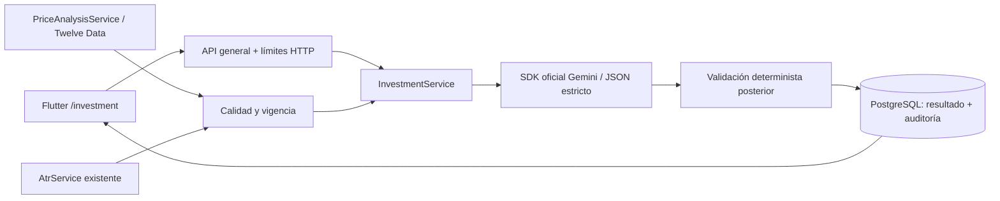

# Sprint 4 — Agente Gemini general para NASDAQ 100 / QQQ

## Alcance acordado e inspección

Se implementó la historia con la corrección posterior del propietario: **agente general, sin roles ni administración de usuarios; reutilizar el proveedor del `.env`**. No hay login, registro, cuentas ficticias ni un sistema de portafolios paralelo. Las consultas y decisiones pertenecen al ámbito compartido `general`; no se atribuyen a una identidad individual. Esta corrección sustituye los apartados de autenticación por inversionista y aislamiento de portafolios del documento inicial.

Inspección: backend TypeScript/NestJS 10, runtime CI Node 20, PostgreSQL/TypeORM con migraciones, Redis y Socket.IO; Flutter/Dart con Riverpod, GoRouter y Dio; Jest y Flutter Test; CI en GitHub Actions. No se encontraron AGENTS.md, autenticación de inversionistas, posiciones persistidas ni integración IA anterior. El modelo `SIMPLE_2X` existente es académico, no un balance de cuenta: no se utiliza como capital real. Se conservan stop-loss, IOC, push, gráficos y backtesting existentes.

La configuración local inspeccionada selecciona **Twelve Data, realtime, QQQ**. Su API key entrega mercado, no una cuenta de broker. No existe `IBKR_PAPER_ACCOUNT` en ese `.env`. La integración IOC del Sprint 3 es independiente y este agente no la invoca. **No se pueden validar compras o ventas personales sin capital, posiciones y políticas verificables.** El agente genera análisis general y escenarios; el resultado final se mantiene en **ABSTENERSE, operable=false** por contexto financiero ausente. No se simulan saldos para habilitar señales.

## Arquitectura y límites de confianza



- `InvestmentMarket` reutiliza historial en memoria y ATR del proveedor ya configurado. Conserva timestamps originales, diferencia NDX del ETF QQQ, y devuelve volumen `null` cuando Twelve Data no lo publica. Variación sobre la referencia disponible de al menos diez segundos, no variación diaria inventada.
- `investment.risk.ts` valida mercado y políticas independientemente del modelo. No modifica la configuración de stop-loss o hedging. El contrato financiero y sus reglas están probados con fixtures; en operación general no existe una fuente de cuentas y el contexto es `null`.
- `GeminiClient` usa `@google/genai` 2.32, compatible con Node 20 del proyecto, `models.generateContent`, salida JSON y esquemas Zod estrictos. Modelo predeterminado `gemini-3.8-flash`; versión concreta devuelta por el proveedor en `modelVersion`; prompt `investment-v1`.
- El contenido externo no es una instrucción autorizada. Se limita entrada/salida, no se proporcionan herramientas, ejecución de código ni acceso al broker. Se rechazan estructuras extra, enlaces, código y ciertas instrucciones operativas. El filtrado textual es defensa adicional, no una garantía absoluta contra toda prompt injection. Los controles deterministas y la ausencia de herramientas son el límite efectivo de ejecución.
- `InvestmentStore` utiliza consultas parametrizadas, claves únicas, transacciones y cuotas PostgreSQL compartidas entre instancias. No guarda claves ni respuestas crudas del proveedor. Registra snapshot, resultado validado, versiones, motivos, consulta, seguimiento y decisión humana.
- Flutter presenta carga, validación, abstención, falta de datos, vencimiento, servicio no disponible y errores de acceso del servidor. Las decisiones **SEGUIR/DESCARTAR/POSPONER** solo se registran: no hay una orden solicitada, aceptada o ejecutada.

## Contrato de API

Rutas bajo `/api/investment/recommendations`, ámbito general sin autenticación individual por la instrucción del propietario. No enviar información privada en preguntas. El despliegue remoto debe usar HTTPS; Flutter bloquea HTTP remoto salvo loopback y emulador Android. No se añadieron interfaces para modificar posiciones ni límites de riesgo.

| Método / ruta | Entrada | Resultado |
|---|---|---|
| POST `/api/investment/recommendations` | Header `Idempotency-Key`: UUID; JSON `{ "symbol": "QQQ", "quantity": 1 }` | 201: recomendación persistida o resultado previo de esa clave |
| GET `/api/investment/recommendations/:id` | UUID | 200: resultado y `expired`; registra consulta |
| POST `/:id/questions` | Header `Idempotency-Key`: UUID; `{ "question": "¿Cuáles son los riesgos?" }` | 201: explicación vinculada a la recomendación original |
| POST `/:id/decision` | `{ "decision": "POSPONER" }` | 201: decisión humana compartida, fecha, `NO_ORDER_REQUESTED` |

`symbol` solo acepta QQQ. `quantity` es entero entre 1 y 1.000.000, una cantidad para evaluar, no una orden. Las preguntas tienen 3–500 caracteres. Campos desconocidos, capital enviado desde el cliente, NDX como instrumento, cantidades inválidas o `execute` se rechazan con 400. Decisiones humanas: SEGUIR, DESCARTAR, POSPONER; una decisión existente no se cambia silenciosamente. Repetir el mismo valor devuelve el registro; cambiarlo produce 409.

Códigos HTTP: 400 entrada inválida, 404 recomendación no encontrada, 409 clave con otro contenido/solicitud en curso/decisión distinta, 429 límite HTTP o de recurso cuando se propaga, 503 persistencia u otro fallo técnico de la API. Un fallo de generación se **persiste** y devuelve 201 con `status=NO_DISPONIBLE`, `decision=null`; no es una señal financiera. La cuota reservada para Gemini puede producir ese estado técnico. Los errores no devuelven mensajes crudos ni claves.

Respuesta de recomendación: `id`, `correlationId`, `scope=GENERAL`, `instrument` (nombre, símbolo, tipo, mercado, moneda, índice, relación y límites del proxy), `quantity`, `decision`, `status`, `horizon`, `justification`, `indicators`, `sources`, `riskValidation`, `uncertainty`, `limitations`, `generatedAt`, `validUntil`, `promptVersion`, `model`, `modelVersion`, `operable=false`, `humanConfirmationRequired=true`, `orderStatus=NO_ORDER_REQUESTED`. Cuando Gemini responde se incluyen `risks`, `favorable`, `adverse`, `invalidation`. Los datos ausentes permanecen ausentes o `null`; no se rellenan con hechos ficticios. Las fechas son milisegundos UTC; la interfaz las presenta en hora local.

Estados: `READY` para análisis procesado (puede ser ABSTENERSE); `DATOS_INSUFICIENTES` con ABSTENERSE; `NO_DISPONIBLE` con decisión nula. Una respuesta de seguimiento conserva `recommendationId` y `originalDecision`, con `answer`, `requiresNewEvaluation`, versiones y correlationId propios. Si la evaluación venció se exige una nueva; no se obtienen hechos actuales a través de preguntas ni se altera la recomendación original. Las peticiones de ejecutar o eludir controles se rechazan como `CONSULTA_RESTRINGIDA`.

## Controles y vigencia

Mercado: proveedor permitido, fuente no simulada, QQQ, cotización presente y finita, timestamps no futuros, continuidad/frescura del servicio existente, histórico previo, salto entre referencia y precio no mayor al 20%, ATR `ready` positivo y fresco. Esto detecta inconsistencias internas; no hay contraste entre dos proveedores independientes.

Se utiliza horario de Nueva York con DST, lunes a viernes 09:30–16:00 y además se exige fuente viva. No se implementa un calendario de festivos/cierres anticipados; fuera de esa ventana se abstiene, sin extender la caducidad del viernes al fin de semana. La frescura del pipeline existente puede ser más estricta que la máxima del agente.

Motor financiero: capital para precio más un buffer explícito de costos de 10 bps, exposición actual y posterior, límite por instrumento, riesgo por operación según stop-loss, posición para vender, instrumento habilitado, horizonte permitido, volatilidad máxima, cobertura obligatoria y restricciones operativas. Son reglas conservadoras: incluso una venta reductora puede quedar bloqueada por una política incumplida. No modelan adecuación regulatoria, liquidez, impuestos ni riesgo completo de cartera. No sustituyen la validación de órdenes del broker.

Después de Gemini se recaptura el mercado y contexto: se invalidan datos vencidos, cambios de contexto y movimiento de precio superior a 0,1%. La vigencia final es el mínimo de TTL de recomendación, precio, ATR y contexto si existe. La incertidumbre es cualitativa, sin porcentajes de confianza calibrados inventados.

## Configuración y operación

Se conservan las variables existentes `MARKET_DATA_*` y `TWELVE_DATA_API_KEY`; no se copian claves a Flutter. `.env` permanece fuera de Git.

| Variable | Valor predeterminado / función |
|---|---|
| `GEMINI_ENABLED` | false; habilitación explícita |
| `GEMINI_API_KEY` | vacía; credencial backend obtenida de Google |
| `GEMINI_MODEL` | gemini-3.8-flash |
| `GEMINI_TIMEOUT_MS` | 15000, rango 1000–30000 |
| `INVESTMENT_GENERAL_CALLS_HOUR` | 10 por ámbito general compartido |
| `INVESTMENT_SERVICE_CALLS_HOUR` | 100 por servicio |
| `INVESTMENT_QUOTE_MAX_AGE_MS` | 30000, rango 1000–60000 |
| `INVESTMENT_ATR_MAX_AGE_MS` | 180000, rango 60000–600000 |
| `INVESTMENT_CONTEXT_MAX_AGE_MS` | 300000, reservado al contrato de contexto verificable |
| `INVESTMENT_VALIDITY_MS` | 30000, máximo 60000 |
| `INVESTMENT_RETENTION_DAYS` | 90, rango 7–365 |

Límites HTTP: 60 solicitudes/minuto por IP (hash, sin guardar IP en texto), 600/minuto globales. Son ventanas fijas en PostgreSQL. No equivalen a una defensa completa contra DDoS; el despliegue general debe mantener los límites de red del proyecto. Las cuotas Gemini se reservan antes de invocar y se consumen también en fallos, evitando reintentos gratuitos ilimitados.

Un intento de generación por solicitud; SDK `retryOptions.attempts=1`, máximo 4096 tokens de salida. No se reintentan automáticamente timeouts ni fallos ambiguos que puedan duplicar consumo. El cierre de conexión cancela localmente mediante AbortSignal; Google puede haber empezado a procesar y facturar. Repetir una clave devuelve el resultado guardado. Una caída del proceso puede dejar PROCESSING: 409 y revisión operativa, sin duplicar generación a ciegas.

Migración nueva `1794186000000-InvestmentRecommendations`, sin alterar migraciones históricas. Tablas `investment_requests`, `investment_recommendations`, `investment_decisions`, `investment_audit`, `investment_quotas`; índices y referencias en PostgreSQL. `npm run investment:purge` aplica retención a recomendaciones, solicitudes, auditoría y contadores expirados; ejecutar únicamente sobre la base prevista y con la política acordada. Elimina datos antiguos, incluidas sus claves de idempotencia; no reusar claves históricas.

Para habilitar: instalar dependencias con `npm ci`, configurar PostgreSQL y el feed existente, añadir localmente `GEMINI_API_KEY` y `GEMINI_ENABLED=true`, iniciar backend (`npm run start:dev`) y abrir el icono del asistente en el dashboard Flutter. El ATR necesita suficiente historial y el mercado debe estar vigente. No se requiere introducir usuarios ni roles.

## Pruebas reproducibles

```sh
# backend/
npm run build
npm run lint
npm run test:investment
# PostgreSQL de pruebas, nunca datos productivos:
RUN_INVESTMENT_DB_TESTS=1 DB_PORT=<puerto> DB_USER=<usuario> DB_PASSWORD=<clave_test> DB_NAME=<base_test> npm run test:investment
npm run gemini:probe
# Solo si se dispone de dataset QQQ y señales históricas verificables:
npm run investment:backtest -- /ruta/qqq.json /ruta/recomendaciones.json

# frontend_mobile/
flutter analyze
flutter test test/investment_test.dart
```

La suite PostgreSQL crea un schema único, aplica la migración y lo elimina al terminar. Prueba HTTP real, persistencia, auditoría, cuotas concurrentes, claves repetidas, cambio de precio, validación, abstención, errores y decisiones. Gemini y mercado se simulan exclusivamente en tests, sin llamadas facturables.

E2E completo: iniciar `npx ts-node src/modules/investment/testing/serve-e2e.ts` en backend con las variables de base de prueba y `RUN_INVESTMENT_DB_TESTS=1`; su salida proporciona URL efímera. Desde Flutter: `flutter test test/investment_live_test.dart --dart-define=INVESTMENT_E2E_URL=<url>`. Usa Flutter real, transporte HTTP real, API y PostgreSQL reales; **mercado y Gemini son fixtures identificados como E2E_SIMULATED**. Terminar el harness con SIGTERM para limpiar su schema.

`gemini:probe` usa una llamada real, sin datos financieros privados, y exige una respuesta estructurada de abstención ante ausencia de datos. Registra modelo y versión del prompt, no la clave. Sin credencial devuelve NO_EJECUTADA y código de salida 2. Nunca forma parte de CI normal.

## Evaluación histórica

`evaluateRecommendations` reutiliza `parseDataset` del backtesting existente y exige muestras QQQ, procedencia, versión, capital inicial, costos, slippage y tolerancia de huecos. El segundo JSON contiene `trainingEndsAt` y `recommendations`: id, generatedAt, dataUntil, decision, quantity, promptVersion y modelVersion. El entrenamiento termina antes del conjunto de evaluación. Se rechazan señales duplicadas, desordenadas, fuera de ventana o con `dataUntil > generatedAt`.

Las señales actúan únicamente en una observación posterior a su generación; nunca en el mismo precio usado para producirla. Se compara contra buy-and-hold QQQ, con costos y slippage constantes. Métricas: retorno, volatilidad por observación, drawdown, exposición media, operaciones, costos y retorno/volatilidad no anualizado. Se registran hashes de ambos archivos y períodos para reproducibilidad. No se ejecuta Gemini retrospectivamente sobre todo el dataset ni se presenta entrenamiento del LLM como libre de información futura.

No existe un dataset histórico QQQ verificable con recomendaciones contemporáneas en el repositorio. El dataset de estrés existente es sintético y corresponde a otra evaluación. **Backtest financiero histórico: NO EJECUTADO.** Las tres pruebas sintéticas verifican únicamente el evaluador, costos y rechazo de look-ahead; no son evidencia de rentabilidad.

## Evidencias y estado

Evidencia automática en `reportes/gemini-2026-11-08/`. El informe final registra los resultados y comandos realmente ejecutados. La clave Gemini está ausente: integración implementada, conexión real NO EJECUTADA. Sin capital/posiciones provenientes de broker no hay recomendación personal operable. El alcance general solicitado está implementado; no se certifican CA-01 personal ni CA-07 histórico/Gemini real del documento inicial.

Modelo estable vigente comprobado en la [ficha oficial de Gemini 3.8 Flash](https://aistudio.google.com/docs/models/gemini-3.8-flash); nivel de razonamiento LOW, sin usar MINIMAL no soportado.

Fuentes técnicas oficiales consultadas: [SDK Google Gen AI](https://googleapis.github.io/js-genai/release_docs/index.html), [configuración de generación](https://googleapis.github.io/js-genai/release_docs/interfaces/types.GenerateContentConfig.html), [timeouts y reintentos](https://googleapis.github.io/js-genai/release_docs/interfaces/types.HttpOptions.html), [salida estructurada Gemini](https://ai.google.dev/gemini-api/docs/structured-output). La compatibilidad Node >=20 de la rama 2.x se comprobó en los metadatos oficiales del paquete npm.

### Resultado de la verificación local — 8 de noviembre de 2026

| Verificación | Resultado |
|---|---|
| Regresión backend | 412 aprobadas, 0 fallidas, 9 omitidas de la integración Redis separada |
| Módulo investment | 53 aprobadas: 37 unitarias, 13 integración HTTP/PostgreSQL y 3 del evaluador histórico sintético |
| Regresión Flutter | 38 aprobadas, 2 pruebas de transporte vivo omitidas en la suite estándar |
| Flutter/API/PostgreSQL E2E separado | 1 aprobada, con mercado y Gemini simulados; cubre una de las dos omitidas arriba |
| Compilación backend y Flutter web | Aprobadas |
| Análisis Flutter | Sin incidencias |
| ESLint | Sin errores; tres advertencias previas en pruebas del broker; módulo investment sin incidencias |
| Escaneo de secretos conocidos del `.env` en cambios | Aprobado; `.env` no modificado ni versionado |
| Gemini real | NO EJECUTADA: falta `GEMINI_API_KEY`; cero llamadas |
| Backtest histórico real | NO EJECUTADO: falta dataset QQQ y señales contemporáneas verificables |

Las siete pruebas de seguridad de la API (entradas indebidas, instrucciones de ejecución, referencias inválidas/decisión inmutable y concurrencia de cuotas) forman parte de las 13 de integración, no se suman como pruebas nuevas. El E2E no demuestra una respuesta real de Google. El build web emitió avisos del paquete Socket.IO en la comprobación opcional de Wasm; la compilación JavaScript terminó correctamente.

**Estado: IMPLEMENTADA CON OBSERVACIONES para el alcance general corregido.** Backend, interfaz, persistencia, seguimiento, decisión humana, controles y herramientas de evaluación están implementados y probados localmente. La integración externa Gemini y la evaluación histórica siguen pendientes; no se declara la historia original COMPLETADA Y VERIFICADA. Las recomendaciones personales operables y el aislamiento por usuario del documento inicial no pertenecen al alcance general solicitado posteriormente.
