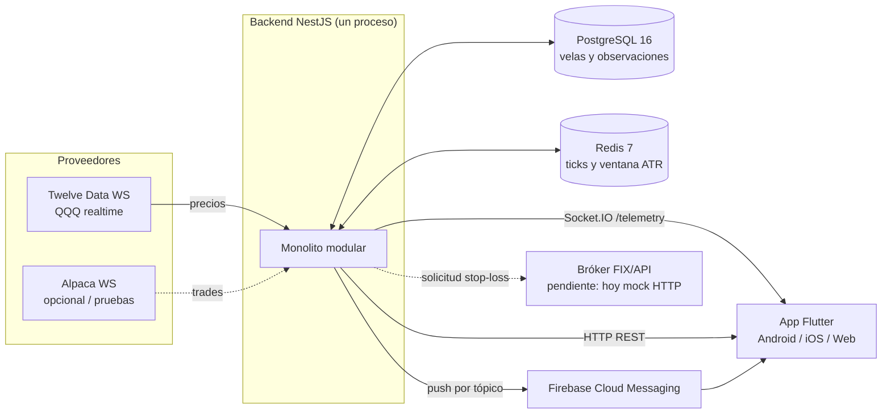
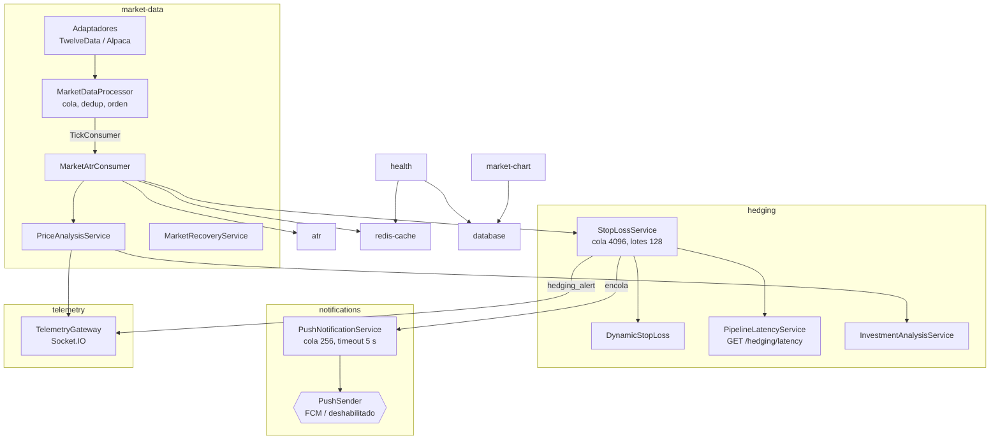
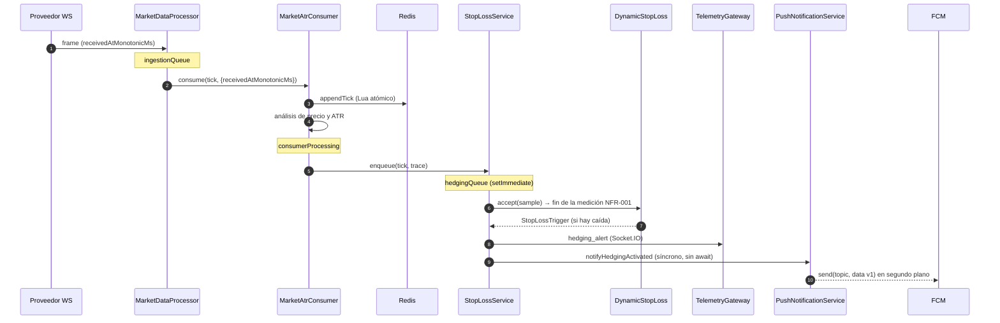
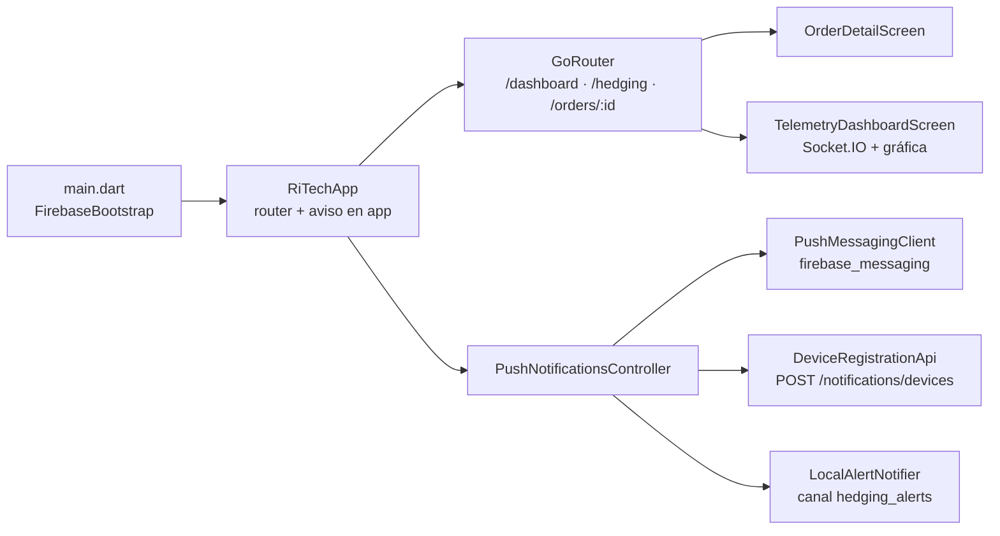
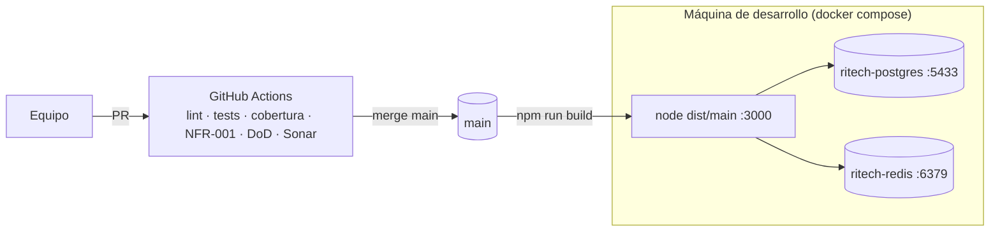

# Arquitectura implementada

Este documento describe el código de `main` al 4 de noviembre de 2026. La decisión de fondo está en el [ADR 0001](adr/0001-monolito-modular.md) y la operación, en el [runbook](runbook.md).

## Contexto

## Módulos del backend

## Camino crítico: tick → decisión → alerta

`/hedging/latency` reporta p50, p95 y máximo por tramo, además del `slowestSegment`. El reporte reproducible se genera con `npm run qa:latency -- --redis` y queda en `reportes/latencia/`.

## Contratos versionados

| Canal | Evento / ruta | Versión | Productor → consumidor |
| --- | --- | --- | --- |
| Socket.IO `/telemetry` | `telemetry_tick`, `atr_result`, `chart_candle`, `price_alert`, `investment_update`, `market_data_quality` | `schemaVersion` en el tick | Backend → app |
| Socket.IO `/telemetry` | `hedging_alert` (`action: STOP_LOSS_REQUEST`, `executionStatus: REQUESTED`) | `schemaVersion: 1` | Backend → app |
| FCM `data` | `type: HEDGING_ACTIVATED`, `correlationId`, `symbol`, `policy`, `price`, `fallPercentPerMinute`, `triggeredAtMs`, `route` | `schemaVersion: "1"` | Backend → app |
| HTTP | `POST/DELETE /notifications/devices`, `GET /notifications/status` | n/a | App → backend |
| HTTP | `GET /hedging/latency`, `GET /health`, `GET /market-data/status`, `/market-data/*`, `/atr` | n/a | Operación / app |

La app Flutter **descarta** los payloads push con otra versión o con campos inválidos. La ruta de navegación se reconstruye en el cliente a partir de `correlationId` y nunca se toma del campo `route` del payload.

## App móvil

| Estado de la app | Quién muestra la alerta | Cómo se abre el detalle |
| --- | --- | --- |
| Foreground | Notificación local, más un aviso con el botón «Ver» | Toque → `openAlert` → `/orders/:id` |
| Background | El sistema operativo (bloque `notification` de FCM) | `onMessageOpenedApp` |
| Terminada | El sistema operativo | `getInitialMessage`, que queda pendiente hasta el primer frame |

## Despliegue actual

La contenerización y el despliegue a producción siguen pendientes ([Contenerizar y desplegar a producción](https://app.clickup.com/t/86e390ze5)). Cuando existan, este diagrama y el runbook deben actualizarse con el destino real.
