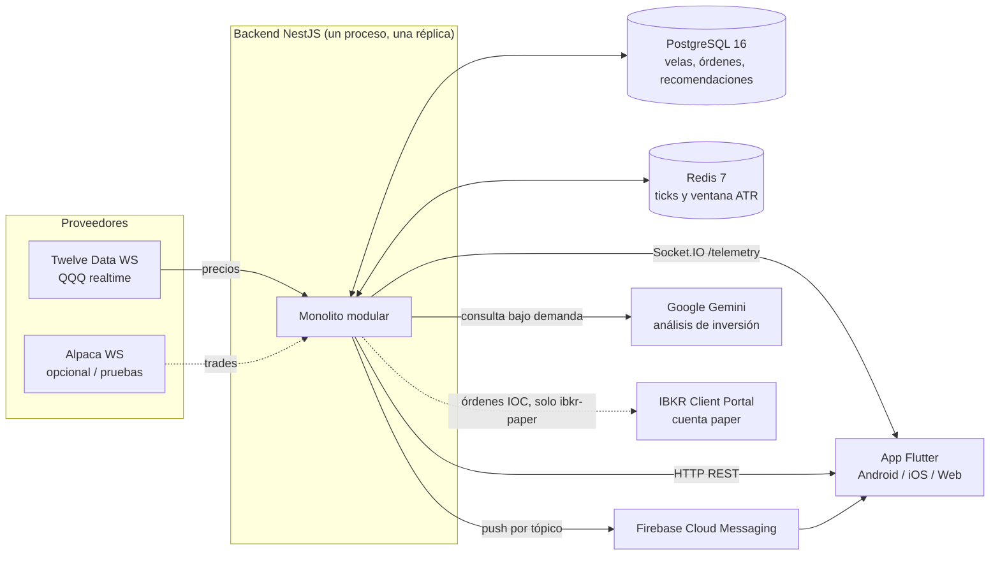
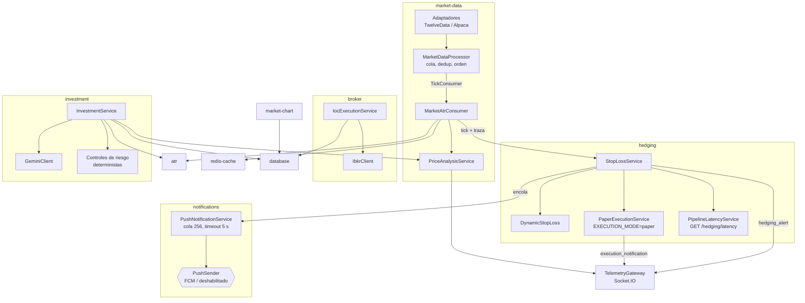
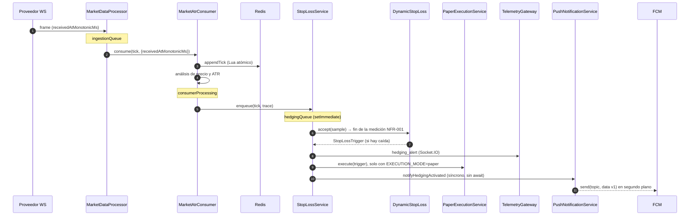
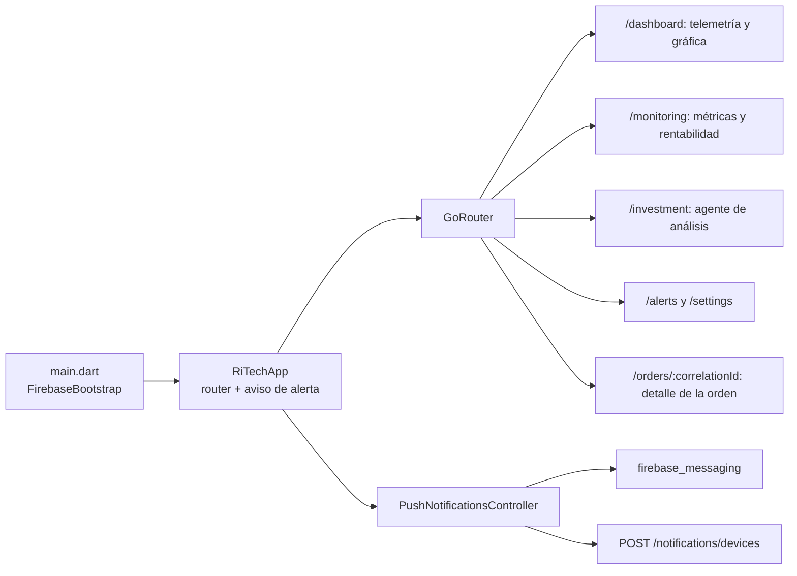
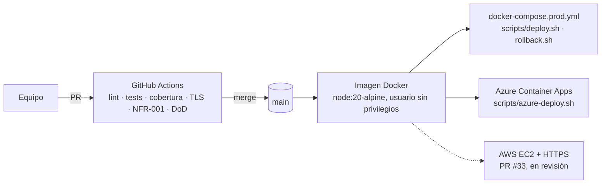

# Arquitectura implementada

Este documento describe el código de `main` al 9 de noviembre de 2026 (commit `c60a1ab`, cierre del sprint 4). La decisión de fondo está en el [ADR 0001](adr/0001-monolito-modular.md) y la operación, en el [runbook](runbook.md).

## Contexto

Las líneas punteadas son integraciones opcionales que dependen de la configuración del ambiente. Con TLS habilitado, el backend acepta solo HTTPS con TLS 1.3 y exige TLS verificado hacia PostgreSQL y Redis.

## Módulos del backend

| Módulo | Responsabilidad | Autor principal |
| --- | --- | --- |
| `market-data` | Adaptadores Twelve Data y Alpaca, cola acotada, deduplicación, recuperación tras cortes | Dylan |
| `atr` | ATR de 1 minuto y alerta de volatilidad | Diego |
| `market-chart` | Archivo de precios y velas por jornada en PostgreSQL | Dylan |
| `hedging` | Stop-loss dinámico, ejecución simulada (paper), medición de latencia NFR-001 | Diego y Danilo |
| `notifications` | Cola y envío de alertas push por FCM, registro de dispositivos | Danilo |
| `broker` | Órdenes IOC a IBKR paper con reintentos limitados y auditoría | Dylan |
| `investment` | Agente de análisis con Gemini, controles de riesgo y auditoría de recomendaciones | Diego y Dylan |
| `backtesting` | Motor de backtesting reproducible con dataset versionado | Diego |
| `telemetry` | Gateway Socket.IO `/telemetry` hacia la app | Juan José, extendido por Diego y Dylan |
| `database` | Entidades de cartera y migraciones | Juan José y equipo |
| `redis-cache`, `health` | Caché de ticks y verificación de salud | Equipo |

El despliegue (Dockerfile, `docker-compose.prod.yml`, scripts de despliegue y Azure) es de Juan José; TLS 1.3 de entrada y hacia los almacenes de datos, de Diego.

El stop-loss no llama al bróker IBKR de forma automática: la señal no trae contrato, tamaño ni lado de cobertura, así que `IocExecutionService` se usa solo con datos explícitos (comando `npm run broker:ioc`). El agente de inversión tampoco tiene acceso al bróker.

## Camino crítico: tick → decisión → alerta

Cada salida del stop-loss está envuelta en su propio `try/catch`: una falla en Socket.IO, en la ejecución simulada o en push no impide las demás ni detiene el motor. La latencia medida en el CI del 9 de noviembre (200 ticks/s, Redis real) fue p50 0,76 ms, p95 1,46 ms y máximo 12,06 ms.

## Contratos versionados

| Canal | Evento / ruta | Versión | Productor → consumidor |
| --- | --- | --- | --- |
| Socket.IO `/telemetry` | `telemetry_tick`, `atr_result`, `chart_candle`, `price_alert`, `investment_update`, `market_data_quality` | `schemaVersion` en el tick | Backend → app |
| Socket.IO `/telemetry` | `hedging_alert` (`action: STOP_LOSS_REQUEST`) | `schemaVersion: 1` | Backend → app |
| Socket.IO `/telemetry` | `execution_notification` (aceptación simulada) | `schemaVersion: 1`, `simulated: true` | Backend → app |
| FCM `data` | `type: HEDGING_ACTIVATED`, `correlationId`, `symbol`, `policy`, `price`, `fallPercentPerMinute`, `triggeredAtMs`, `route` | `schemaVersion: "1"` | Backend → app |
| HTTP | `POST/GET /api/investment/recommendations`, decisión humana | `Idempotency-Key` obligatorio | App → backend |
| HTTP | `POST/DELETE /notifications/devices`, `GET /notifications/status` | n/a | App → backend |
| HTTP | `GET /hedging/latency`, `GET /health`, `/market-data/*`, `/atr` | n/a | Operación / app |

## Datos persistidos (PostgreSQL)

| Migración | Tablas | Uso |
| --- | --- | --- |
| `1791345600000-MarketChartArchive` | `market_chart_observations`, `market_chart_candles` | Historial de precios y velas por jornada |
| `1794153600000-BrokerOrders` | órdenes y `broker_order_events` | Idempotencia y auditoría de órdenes IOC |
| `1794186000000-InvestmentRecommendations` | recomendaciones y auditoría | Resultado validado, versiones, consulta y decisión humana |
| `1794204000000-PortfolioEntities` | `users`, `assets`, `positions`, `orders`, `hedge_rules`, `hedge_logs` | Modelo de cartera |

TypeORM aplica las migraciones al arrancar; `synchronize` está desactivado.

## App móvil

| Estado de la app | Quién muestra la alerta | Cómo se abre el detalle |
| --- | --- | --- |
| Foreground | Notificación local, más un aviso con el botón «Ver» (15 s) | Toque → `openAlert` → `/orders/:id` |
| Background | El sistema operativo (bloque `notification` de FCM) | `onMessageOpenedApp` |
| Terminada | El sistema operativo | `getInitialMessage`, pendiente hasta el primer frame |

Verificado en emulador Android API 36 el 7 de noviembre de 2026. iOS está configurado pero sin verificar en dispositivo (excepción acordada: requiere Mac y cuenta de Apple Developer).

## Despliegue

| Destino | Estado en `main` | Detalles |
| --- | --- | --- |
| Servidor con Docker Compose | Implementado | `docker-compose.prod.yml` con PostgreSQL, Redis y backend; health check de 15 s; `deploy.sh` guarda la etiqueta anterior y `rollback.sh` la restaura |
| Azure Container Apps | Script implementado | PostgreSQL Flexible Server, Redis externo (Upstash), 0 a 1 réplicas, ingreso HTTPS; datos de mercado y FCM deshabilitados por defecto |
| AWS EC2 | PR #33 abierto | HTTPS con TLS 1.3, Secrets Manager, Flutter web público; instancia única, sin respaldos automáticos |

En todos los casos corre **una sola réplica** del backend, como exige el ADR 0001: el estado del episodio de stop-loss vive en memoria.
